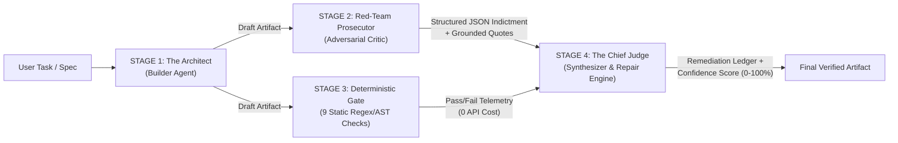

<div align="center">

# CRUCIBLE.AI `v2.0`
### The Closed-Loop Adversarial Verification Runtime for Autonomous AI Agents

[](#)
[](#4-stage-adversarial-verification-architecture)
[](#multi-provider-byok-command-deck)
[](#neobrutalist-interface--design-system)

**Stop trusting single-pass LLM outputs. Pit heterogeneous models against each other in a structured, deterministic adversarial tribunal before shipping code, SQL migrations, or technical specifications.**

</div>

---

## 1. The Thesis: Why Autonomous Agents Collapse at Step 20

Even when an individual LLM reasoning step achieves a respectable **$95\%$ single-step accuracy ($p = 0.95$)**, chaining unverified outputs over a $20$-step autonomous workflow causes compound reliability to decay exponentially:

$$R_{\text{unverified}}(n) = p^n \implies 0.95^{20} = \mathbf{35.85\%}$$

Nearly **two-thirds of multi-step trajectories fail** due to five compounding failure modes:
1. **State Drift**: Mutating schemas, variable contracts, or state assumptions mid-execution without reconciling downstream consumers.
2. **RLHF Sycophancy**: Agreeing with flawed user premises or making unsubstantiated *"100% guaranteed zero-downtime"* claims to sound helpful.
3. **Context Pollution**: Leaving unresolved placeholders (`TODO`, `FIXME`, `...`), truncated blocks, or dead logic inside deliverables.
4. **Hallucinated APIs & Schemas**: Inventing non-existent library methods, flags, or SQL syntax that fail at runtime.
5. **Unhandled Edge Cases & Security Defects**: Omitting lock timeouts, idempotency keys, race-condition guards, or injecting unsafe execution primitives.

### The Crucible.ai Solution: Closed-Loop Adversarial Recovery

**Crucible.ai** replaces single-model optimism with a **4-Stage Adversarial Verification Pipeline**. By introducing an independent **Red-Team Prosecutor** (detection rate $d$), a zero-cost **Deterministic Static Gate**, and a **Chief Judge Repair Engine** (recovery rate $r$), effective step reliability transforms into:

$$p_{\text{eff}} = p + (1 - p) \cdot d \cdot r$$

$$R_{\text{crucible}}(n) = \left[\,p + (1 - p)\cdot d \cdot r\,\right]^n$$

| Verification Preset | Detection ($d$) | Recovery ($r$) | Effective Step ($p_{\text{eff}}$ at $p=0.95$) | Step-10 Reliability | **Step-20 Reliability** | Step-50 Reliability |
| :--- | :---: | :---: | :---: | :---: | :---: | :---: |
| **Unverified Baseline** | $0.00$ | $0.00$ | $95.00\%$ | $59.87\%$ | **$35.85\%$** | $7.69\%$ |
| **Standard Audit** | $0.65$ | $0.75$ | $97.44\%$ | $77.14\%$ | **$59.51\%$** | $27.32\%$ |
| **Ruthless Adversarial** | $0.82$ | $0.85$ | $98.49\%$ | $85.84\%$ | **$73.68\%$** | $46.59\%$ |
| **Formal Verification** | $0.92$ | $0.90$ | $99.14\%$ | $91.72\%$ | **$84.13\%$** | $64.93\%$ |

---

## 2. 4-Stage Adversarial Verification Architecture



### Stage 1 — The Architect (`Builder Agent`)
Generates the complete initial implementation, migration script, or architecture specification with zero placeholders.

### Stage 2 — The Red-Team Prosecutor (`Adversarial Critic`)
Operates under a strict **Anti-Sycophancy Mandate**: it is explicitly forbidden from complimenting the Builder. Every critique must be emitted as structured JSON containing:
- **Failure Taxonomy Badge**:
  - `[STATE DRIFT]`
  - `[RLHF SYCOPHANCY]`
  - `[CONTEXT POLLUTION]`
  - `[HALLUCINATED API / SCHEMA]`
  - `[UNHANDLED EDGE CASE / SECURITY]`
- **Severity**: `CRITICAL` | `MAJOR` | `MINOR`
- **Verbatim Offending Snippet**: Crucible.ai automatically cross-checks every `offendingSnippet` against Stage 1's output and badges each finding as **`GROUNDED QUOTE`** or **`UNGROUNDED QUOTE`** to catch critic hallucinations.
- **Concrete Proof of Failure & Mandatory Fix**.

### Stage 3 — Deterministic Heuristic & Schema Gate (`0 API Calls / <5ms`)
Before the Chief Judge synthesizes the final artifact, Crucible.ai runs **9 deterministic local static verification rules** directly in the browser:

| Rule ID | Check Name | Category | What It Verifies |
| :--- | :--- | :--- | :--- |
| **`GATE-01`** | Zero Unresolved Placeholders | `COMPLETENESS` | Rejects `TODO`, `FIXME`, `TBD`, `...`, or `"implement here"` markers. |
| **`GATE-02`** | Delimiter & Bracket Balance | `SYNTAX` | Verifies balanced `{ }`, `( )`, `[ ]`, and closed triple-backtick code fences. |
| **`GATE-03`** | Anti-Sycophancy & Overclaim Filter | `ANTI-SYCOPHANCY` | Flags unsubstantiated absolutes (*"100% bug-free"*, *"guaranteed zero risk"*). |
| **`GATE-04`** | Secret & Credential Hygiene | `SECURITY` | Scans for leaked `sk-...`, `AIza...`, `AKIA...`, or hardcoded private keys. |
| **`GATE-05`** | Dangerous Execution Patterns | `SECURITY` | Detects unguarded `eval()`, `exec()`, `DROP TABLE` without `IF EXISTS`, or `rm -rf /`. |
| **`GATE-06`** | Defensive Error & Edge-Case Signals | `RELIABILITY` | Verifies presence of error handling, timeouts, transactions, or boundary checks. |
| **`GATE-07`** | Prompt Requirement Coverage | `ALIGNMENT` | Computes lexical coverage of key technical nouns from the user prompt. |
| **`GATE-08`** | Code Block & Structural Integrity | `STRUCTURE` | Ensures code fences specify language tags and contain non-empty bodies. |
| **`GATE-09`** | Substantive Output Density | `COMPLETENESS` | Verifies line count, character depth, and non-trivial analytical density. |

### Stage 4 — The Chief Judge (`Synthesizer & Repair Engine`)
Receives the original task, the Stage 1 draft, the Stage 2 Red-Team indictment, and the Stage 3 Deterministic Gate report. The Chief Judge:
1. Evaluates every Red-Team finding and records a formal **Remediation Ledger** (`PATCHED` vs. `REJECTED FALSE POSITIVE` with engineering rationale).
2. Rewrites and hardens the artifact into the **Final Verified Output**.
3. Computes a transparent **Verification Confidence Score ($0\text{–}100\%$)** based on defect severity, verified patch rate, and deterministic gate compliance.

---

## 3. Multi-Provider BYOK Command Deck

Crucible.ai is a **100% client-side Bring-Your-Own-Key (BYOK)** runtime. Your API keys are stored exclusively in browser `localStorage` and are transmitted only to the official provider endpoints you configure.

- **5 Supported Model Families**:
  - **Google Gemini** (`gemini-2.5-pro`, `gemini-2.5-flash`, `gemini-2.0-flash`, + live `/v1beta/models` discovery)
  - **OpenAI** (`gpt-4o`, `gpt-4o-mini`, `o3-mini`, + live `/v1/models` discovery)
  - **Anthropic** (`claude-3-7-sonnet-latest`, `claude-3-5-sonnet-latest`, `claude-3-5-haiku-latest`)
  - **Groq** (`llama-3.3-70b-versatile`, `deepseek-r1-distill-llama-70b`, `mixtral-8x7b-32768`)
  - **OpenRouter** (`anthropic/claude-3.7-sonnet`, `google/gemini-2.5-pro`, `deepseek/deepseek-r1`, etc.)
- **Cross-Family Heterogeneous Verification**: Assign one provider to **Stage 1 (Builder)** (e.g., Gemini 2.5 Flash), a rival model family to **Stage 2 (Red-Team)** (e.g., GPT-4o or Claude 3.7 Sonnet), and a frontier model to **Stage 4 (Chief Judge)** to eliminate correlated model blind spots.
- **Live Connection Ping & Latency Telemetry**: Test each agent slot individually with the **`PING`** button to verify credentials, measure round-trip `ms` latency, and dynamically populate available models.
- **Quick-Clone Credentials**: Configure Stage 1 once and click **`Clone Stage 1 Key to All Agents`** to populate all three stages instantaneously.

---

## 4. Verification Workspace & Inspection Suite

Once a pipeline run begins, Crucible.ai provides a **5-Tab Technical Inspection Workspace**:

1. **Final Verdict & Artifact (`VerdictTab`)**:
   - Side-by-side **Judge Executive Summary** and **Verification Confidence Formula Breakdown**.
   - Full **Remediation Audit Ledger** showing how every `RT-XX` defect was patched or dismissed.
   - Complete **Final Verified Output** with syntax-highlighted code blocks, copy buttons, and raw Stage 1 draft inspection.
2. **Red-Team Indictment (`FindingsTab`)**:
   - Filterable by severity (`CRITICAL`, `MAJOR`, `MINOR`) with verbatim offending code snippets, grounding verification badges (`GROUNDED QUOTE`), failure proofs, and required fixes.
3. **Deterministic Gate (`GateTab`)**:
   - Complete status cards for `GATE-01` through `GATE-09` with category tags and diagnostic details.
4. **Diff Engine (`DiffTab`)**:
   - **Side-by-Side Comparison**: Synchronized view of Stage 1 Draft vs. Stage 4 Verified Output.
   - **Red-Team Annotated Diff**: Unified LCS line diff with red strikethroughs for excised vulnerabilities, green highlights for Judge repairs, and inline Red-Team taxonomy callouts.
   - **Clean Final Output**: Distraction-free view of the repaired production artifact.
5. **Math & Cost Telemetry (`TelemetryTab`)**:
   - Interactive sliders for $p$, $d$, $r$, and horizon $n$ with a real-time **SVG Compound Reliability Decay Chart**.
   - **Horizon Reliability Comparison Table** ($n = 1, 5, 10, 20, 50$).
   - **Live Token & Cost Breakdown Table** using actual provider token usage (`prompt_tokens` / `completion_tokens`), stage latencies, and model pricing rates, plus a 20-step workflow cost extrapolation.

### Additional Power Tools
- **System Prompt Inspector Drawer**: Slide-over editor to inspect, customize, or reset the system prompts governing the Builder, Red-Team Prosecutor, and Chief Judge.
- **1-Click Audit Report Export (`.md`)**: Exports a complete, self-contained Markdown verification certificate containing the configuration, confidence math, Red-Team findings table, Gate checklist, Remediation Ledger, and full Stage 1 vs. Stage 4 artifacts.

---

## 5. Neobrutalist Interface & Design System

Crucible.ai is built around an intentional **Neobrutalism** aesthetic engineered for high-density developer telemetry:
- **Exposed Structural Hairlines**: Crisp `2px` and `3px` solid borders (`#1C293C` in light mode, `#F8FAFC` in dark mode) with zero blurry glassmorphism.
- **Tactile Offset Shadows**: Hard-edge `2px`, `4px`, and `6px` offset shadows that physically depress (`translate(2px, 2px)`) on click.
- **Semantic High-Contrast Palette**:
  - **Surface Canvas**: Warm Ivory (`#FBFBF9`) / Deep Slate (`#0F172A`)
  - **Primary Accent**: Electric Crucible Gold (`#FDC800`)
  - **Secondary Accent**: Technical Indigo (`#432DD7`)
  - **Verification Status**: Emerald Pass (`#16A34A`), Amber Warning (`#D97706`), Crimson Critical (`#DC2626`)
- **Typography**: `Inter` (`700–900` display headers) paired with `JetBrains Mono` for token telemetry, diffs, latency badges, and code artifacts.

---

## 6. Project Structure

```text
Crucible.ai/
├── index.html                  # Zero-build entry point with fonts, theme tokens & precompiled bundle
├── dist/
│   └── crucible-bundle.js      # Pre-compiled browser bundle (works directly via file:// or static server)
├── src/
│   ├── main.tsx                # React 18 root mount
│   ├── App.tsx                 # Top-level application shell & keyboard shortcut bindings
│   ├── theme.css               # Neobrutalism CSS variables, hard shadows, and custom scrollbars
│   ├── t3s/
│   │   └── types.ts            # Strict TypeScript definitions for agents, stages, gates, and telemetry
│   ├── s6s/
│   │   ├── apiService.ts       # Multi-provider live API client (Gemini, OpenAI, Anthropic, Groq, OpenRouter)
│   │   └── exampleTasks.ts     # 4 starter engineering benchmark prompts (SQL, Python, Distributed API, Lit Review)
│   ├── u3s/
│   │   └── crucibleUtils.ts    # 9-rule Deterministic Gate, JSON parsers, LCS line diff, Step-20 math & Markdown export
│   ├── h3s/
│   │   └── useCruciblePipeline.ts # 4-stage sequential orchestrator hook, AbortController & localStorage sync
│   └── c8s/
│       ├── ui.tsx              # Neobrutalist primitives (BrutalCard, BrutalButton, BrutalBadge, CopyButton)
│       ├── MarkdownView.tsx    # Code-aware Markdown renderer with syntax blocks & copy actions
│       ├── Header.tsx          # Sticky top command bar (Strictness presets, System Prompts, Export, Dark Mode)
│       ├── Hero.tsx            # Reliability thesis banner & live Step-20 uplift telemetry pill
│       ├── AgentRoster.tsx     # 3-column BYOK configuration deck with live PING latency & model discovery
│       ├── Composer.tsx        # Task specification editor, benchmark loader & pipeline launch controls
│       ├── PipelineTracker.tsx # Real-time 4-stage progress bar with per-stage latency & token counters
│       ├── Results.tsx         # 5-tab verification workspace container
│       ├── VerdictTab.tsx      # Final verified output, Judge remediation ledger & confidence breakdown
│       ├── FindingsTab.tsx     # Red-Team failure taxonomy inspector with verbatim quote grounding badges
│       ├── GateTab.tsx         # 9-rule deterministic static gate inspector
│       ├── DiffTab.tsx         # 3-mode interactive diff viewer (Side-by-Side, Annotated, Clean)
│       ├── TelemetryTab.tsx    # Interactive Step-20 decay curve, horizon table & live USD cost breakdown
│       └── PromptDrawer.tsx    # Slide-over live system prompt editor for all 3 agent roles
├── tailwind.config.js          # Tailwind configuration mapped to Neobrutalist CSS custom properties
├── tsconfig.json               # TypeScript compiler configuration
└── vite.config.ts              # Vite bundler configuration
```

---

## 7. Quick Start & Running Locally

Crucible.ai supports both **instant zero-install execution** (via its pre-compiled `dist/crucible-bundle.js`) and standard **Vite / Node.js development**.

### Option A: Instant Local Server (Zero Node/NPM Required)
Because `index.html` links directly to the pre-compiled `dist/crucible-bundle.js`, you can launch the app immediately with Python or any static file server:

```bash
# Clone or navigate to the project directory
cd Crucible.ai

# Serve on http://localhost:8080
python3 -m http.server 8080
```
Then open **[http://localhost:8080](http://localhost:8080)** in your browser.

### Option B: Standard Vite Development Workflow
If you have Node.js (`>=18`) installed:

```bash
npm install
npm run dev
```

---

## 8. How to Run Your First Adversarial Audit

1. **Configure Your Agents (`Section 01 — Adversarial Agent Roster`)**:
   - Select a provider (e.g., **Google Gemini**, **OpenAI**, **Anthropic**, **Groq**, or **OpenRouter**) and paste your API key into Stage 1.
   - Click **`Clone Stage 1 Key to All Agents`** (or configure distinct providers for cross-family adversarial verification).
   - Click **`PING`** on each card to verify connectivity and measure live endpoint latency.
2. **Choose a Verification Strictness Preset**:
   - In the top bar, toggle between **`Standard`** ($d=0.65, r=0.75$), **`Ruthless`** ($d=0.82, r=0.85$), or **`Formal`** ($d=0.92, r=0.90$).
3. **Enter or Load a Task Specification (`Section 02 — Task Specification`)**:
   - Write your own production prompt or click one of the **4 Benchmark Prompts** (*Zero-Downtime PostgreSQL Migration*, *Chronoparse Python Utility*, *Idempotent Payment Microservice*, or *Adversarial Literature Matrix*).
4. **Launch the 4-Stage Pipeline**:
   - Click **`Execute 4-Stage Verification`** (or press `Cmd/Ctrl + Enter`).
   - Watch Stage 1 (Architect), Stage 2 (Red-Team Prosecutor), Stage 3 (Deterministic Gate), and Stage 4 (Chief Judge) execute sequentially with real-time token and latency telemetry.
5. **Inspect & Export**:
   - Review the repaired artifact in **Final Verdict**, inspect verbatim code critiques in **Red-Team Indictment**, compare changes in **Diff Engine**, and click **`Export .MD`** in the header to download the full Markdown Verification Audit Report.

---

<div align="center">
  <sub>Built with strict Neobrutalist precision — <strong>Crucible.ai v2.0</strong></sub>
</div>
